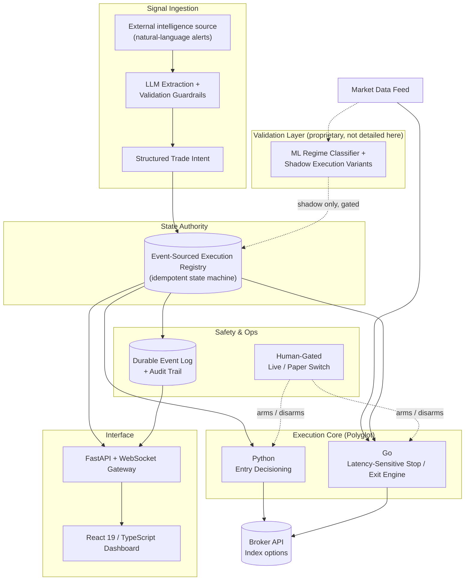

# DeltaLock: LLM-Driven Signal Extraction & Hybrid Execution Engine

**An automated execution system for Indian index options that treats trade-signal generation as an arbitrary external input, and puts all of its engineering into converting that input into safe, disciplined, unattended execution.**

> **This is a portfolio overview repository.** DeltaLock is a private trading system that trades live, with real capital, Monday to Friday. Its source code, extraction pipeline internals, execution parameters, and risk configuration are not published here or anywhere public. This repository documents the architecture, safety design and engineering problems solved. Trading methodology and the origin of trade ideas remain private.
>
> Four of its safety modules also run here: [`extract/`](extract/) holds them with 42 of their
> tests, run by CI on every push.

---

## Project Overview

DeltaLock ingests unstructured, natural-language trade alerts from an external intelligence source, converts them into validated, structured trade intents through an LLM-based extraction pipeline, and executes them through a polyglot Python + Go engine, with no human in the loop once a position is live.

The engineering thesis behind the project is deliberately narrow: **signal quality is treated as a given, not a variable.** DeltaLock does not attempt to generate or improve the underlying trade idea. That already exists before the system sees it. What the system is entirely responsible for is everything downstream of that: can an arbitrary, unverified, natural-language directional call be safely, automatically, and consistently converted into a well-managed trade? That execution problem is what this repository documents.

## Motivation

Most automated-trading portfolio projects concentrate their effort on the signal: a model, an indicator, an edge. DeltaLock inverts that emphasis on purpose. It exists to test a different, and in some ways harder, engineering problem: whether a sufficiently disciplined extraction, guardrail, and execution layer can make an average-quality, uncontrolled input source tradeable while running unattended, without a human validating each alert. That constraint shaped the architecture end to end: an LLM sits at the ingestion boundary specifically because the input is unstructured and adversarial-by-default (inconsistent formatting, duplicates, partial updates), and a dedicated low-latency execution path exists specifically because the *quality* of stop and exit management matters more here than in a system that already starts from a strong signal.

## By the Numbers

| Metric | Value |
|---|---|
| Codebase | 249 Python files, 26 Go files and 39 React/TypeScript components, tracked at the latest commit (4 September 2026) |
| Automated tests | 447 Python test functions across 45 pytest modules and 54 Go test functions across 12 files (static count, latest commit), including regression tests written directly from real production incidents; 42 of the Python tests run in this repository's CI |
| Execution core | Polyglot: Python owns ingestion, entry, and state authority; Go owns latency-sensitive stop/exit management |
| Signal source | Unstructured, natural-language trade alerts, parsed via an LLM-based extraction pipeline with validation guardrails |
| Market | Indian index options, through Dhan's broker API |
| Deployment | Docker Compose, plus native unattended Windows operation |
| Mode | Live with real capital, Monday to Friday; with live armed, every signal also runs as an isolated paper trade |
| Build cadence | 208 commits |

*(Statistics describe engineering scope and testing rigour only; no strategy performance figures, such as returns, win rate, or drawdown, are published here or anywhere publicly, by design.)*

## Run it yourself

[`extract/`](extract/) holds four modules copied from the private repository with 42 of their
tests: the never-short guard, the exit price resolver, the stop-order ledger and the live-stream
field selection. Each file names the private path and commit it came from and lists every edit.
Security ids, quantities, prices and trade ids are placeholders or illustrative values, and the
execution streams carry neutral names, because their real names describe how each one manages
exits. The logic is unchanged.

```bash
cd extract
python -m pip install -e ".[test]"
python -m pytest
```

42 test functions (45 test cases), standard library only. GitHub Actions runs them on Python 3.10
to 3.13 on every push.

## High-Level Architecture



**Deliberately excluded from this diagram:** extraction-guardrail logic, entry/exit trigger conditions, stop-management methodology, and every parameter of the regime classifier. What's shown is the shape of the plumbing, not the logic flowing through it.

## Engineering Challenges

- **Turning unstructured language into a safe, structured action.** The system has no control over its input format. Alerts arrive as free-form text, with duplicates, partial corrections, and inconsistent phrasing. An LLM-based extraction stage converts each message into a schema-validated trade intent, with guardrails that reject duplicate, malformed, or low-confidence signals before any execution logic ever sees them.
- **Polyglot execution for latency-sensitive decisions.** Python owns ingestion, entry and state, where correctness and readability matter most. A purpose-built Go service owns stop and exit management, where consistent low-latency response to tick data matters most. Splitting ownership this way avoided rewriting the whole system in a systems language while still getting the latency-sensitive path out of Python's interpreter/GC path.
- **Crash-safe, replay-recoverable state.** Every lifecycle event is written to a durable, append-only log before it is processed. An idempotent registry persists state, and a restart rebuilds recorded trade state by replaying the log.
- **Paper and live as separate trades.** With live trading armed, every signal becomes two isolated trades: a paper clone that always runs, and a live clone that alone faces the real-money rules. Four execution streams run on every signal and exactly one may touch live money; a candidate replacement runs as a paper-only forward test until the operator promotes it. Live orders pass a five-step gate, from a manual arm to a real authenticated broker call, and their size is set on the server, never by the request. Details in [docs/LIVE-SAFETY.md](docs/LIVE-SAFETY.md).
- **A wall against naked shorts.** The system only buys options and sells what it holds, so every SELL passes one guard at the single function every broker order leaves through. It blocks a sell that the broker's positions do not cover, and a second protective sell against a long that resting orders already cover. It lets a stop loss through when the broker cannot be reached, loudly, because an unprotected long is the worse failure. It does not add a partly covering resting sell to a new one; the reconciler and the exit path handle that case before the wall, as [docs/LIVE-SAFETY.md](docs/LIVE-SAFETY.md) explains.
- **Reconciliation with the broker on every cycle.** In live mode a reconciler thread compares the registry with the broker and repairs the difference. A position the system has no record of is escalated but never touched, a trade closed outside its view is booked from broker records, quantity drift is synced, every stop is checked at the broker, and a position left without a stop is retried and then flattened. Exit prices come from the trade's own orders, never from a position average blended across trades. Details in [docs/RECONCILIATION.md](docs/RECONCILIATION.md).
- **Order sizing in one place.** One function computes every order quantity: the exchange lot times a multiplier the operator sets from the dashboard, separately for paper and live. A change applies to new trades only and persists through an atomic write.
- **Making failures investigable, not just survivable.** A persisted audit trail, a log-explorer UI and regression tests derived from production incidents make failures traceable and check the fixes against recurrence.

## Documentation

The engineering detail lives in `docs/`, and each document stops where the strategy begins.

| Document | What is in it |
|---|---|
| [docs/ORDER-LIFECYCLE.md](docs/ORDER-LIFECYCLE.md) | The order-lifecycle state machine, a sequence diagram of one signal end to end, why entry and exit authority are split across two languages, and how recovery works |
| [docs/DURABILITY.md](docs/DURABILITY.md) | The append-ahead event log, quoted from the real implementation: fsync on the write path, idempotent replay, event-id collision handling, and the partial-fill bug that shaped the API |
| [docs/INVARIANTS.md](docs/INVARIANTS.md) | The invariants the system may never violate, reproduced from the private repository with the trading rules removed |
| [docs/RECONCILIATION.md](docs/RECONCILIATION.md) | Broker reconciliation and recovery: the reconciler's loop, orphans and phantom closes, exit prices from broker truth, naked-position recovery, positions the broker closed itself, and the incidents behind each |
| [docs/LIVE-SAFETY.md](docs/LIVE-SAFETY.md) | The paper and live split, the five-step live gate, order sizing, the never-short wall, the stop-order ledger and stream isolation |
| [extract/README.md](extract/README.md) | The four runnable modules, where each came from and exactly what was changed |
| [docs/INCIDENT-2026-07-15.md](docs/INCIDENT-2026-07-15.md) | A full post-mortem of a live exit that never reached the broker. Two root causes, one of them the kind that leaves the system looking perfectly consistent while being wrong |
| [DISCLOSURE.md](DISCLOSURE.md) | What is published here, what never will be, and the line between them |

## Test suite

447 test functions across 45 pytest modules, plus 54 Go test functions (static count at the latest
commit). The convention across the suite is that a failure in production ships its fix
with a test named for the day it happened, so the same failure cannot return quietly. The
date-suffixed modules below are all real incidents. Forty-two of these tests run in this
repository: see [Run it yourself](#run-it-yourself).

| Module | What it asserts |
|---|---|
| `test_incident_2026_07_15_live_exit.py` | Both root causes of the live exit that never reached the broker. See the post-mortem |
| `test_production_hardening_2026_07_10.py` | Each fix from a pre-live readiness audit, by constructing the exact failure state the fix targets rather than checking that the system boots |
| `test_feed_starvation_2026_08_17.py` | That the system refuses to act on stale market data. In the original incident nothing crashed and no component was wrong, which is why it ran on a market that had stopped updating |
| `test_durability_hardening_2026_08_17.py` | Three backstops that stop a long session degrading, including a sweep for trades left alive after a fill event was missed |
| `test_never_short_2026_08_17.py` | That the system is structurally long-only. An uncovered sell on an index option is a naked short with unbounded loss, so this has to be impossible by construction rather than merely absent from the current call graph (the guard and exit-price tests are in `extract/`) |
| `test_stream_isolation_2026_08_17.py` | That the parallel execution variants never bleed into one another, and that exactly one of them can reach live capital (the selector tests are in `extract/`) |
| `test_no_duplicate_initial_sl_2026_08_18.py` | That one long position can never carry two protective stops, after an incident where two went out a second apart |
| `test_already_covered_sell_2026_08_18.py` | That holding a long is not by itself permission to sell, because the long may already be committed to a protective order that is currently working (in `extract/`) |
| `test_sl_rejection_visibility_2026_08_18.py` | That a rejected stop loss is still recorded after a retry has replaced its order id (the ledger tests are in `extract/`) |
| `test_tick_path_starvation_2026_09_04.py` | That state persistence cannot starve the tick path. Persisting the registry inline on the calling thread measured around 400 ms and was being called once a second per trade |
| `test_state_roundtrip.py` | That serialisation preserves every field, so a restart cannot silently reset state that a dropped field would have reset |
| `test_fifo_purge.py` | First-in, first-out retention of the regime model's observation database |

The remaining modules cover the extraction pipeline, market data handling, the analytics layer
and the strategy internals. They are not listed here, because their names alone describe
trading behaviour.

## Technology Stack

**Backend:** Python 3.11+ (FastAPI, asyncio), Go (execution core), Dhan's broker REST and WebSocket APIs
**Signal Ingestion:** external intelligence source, LLM-based extraction (Google Gemini)
**ML:** LightGBM (experimental market-regime classifier, shadow/validation mode only)
**Frontend:** React 19, TypeScript, Vite, Tailwind CSS, Zustand, Recharts
**Persistence:** durable append-only event log for crash recovery, structured audit trail
**Testing:** pytest (447 test functions across 45 modules) and Go's testing package (54 test functions), including incident-derived regression tests
**Deployment:** Docker Compose, native Windows unattended launchers

## Future Work

- Extend the regime-classification layer beyond shadow/validation mode
- Broaden automated observability around the execution core
- Additional signal-source and broker integrations behind the same extraction/execution boundary

## What This Repository Is Not

This is a documentation showcase with a small runnable extract. It does not include: the extraction pipeline's prompts or guardrail logic, entry/exit trigger conditions, stop-management methodology, risk or sizing configuration, credentials, or any historical performance data. Those remain in a private repository.

---

Built by Aditya Magar. Get in touch via the contact details on my CV or LinkedIn.
